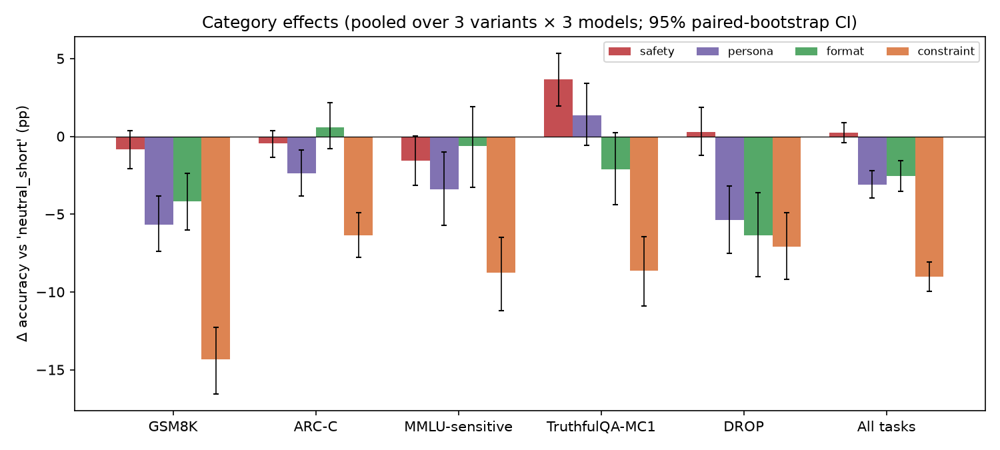
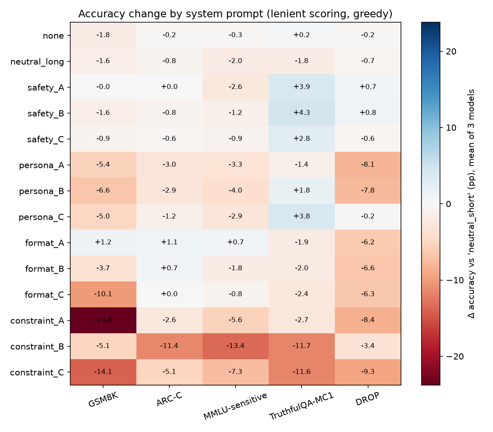
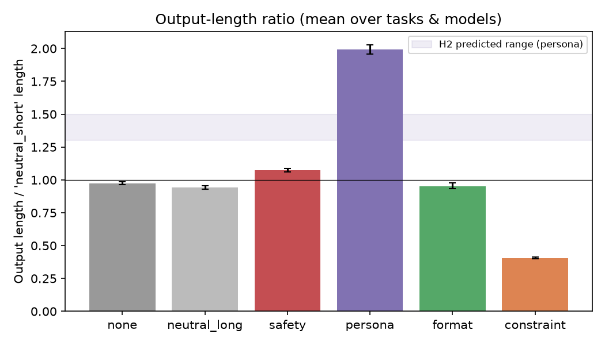
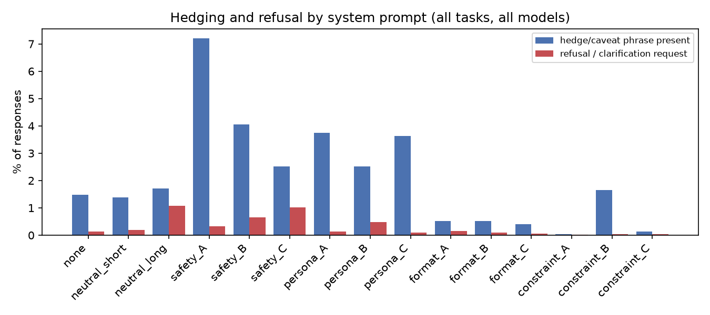
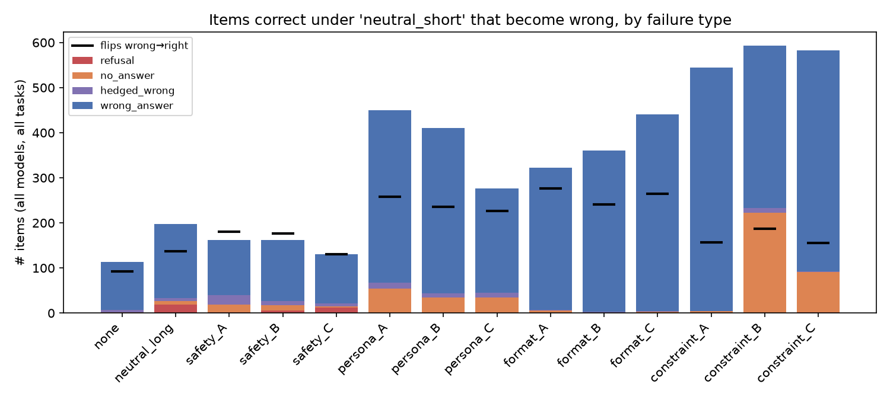
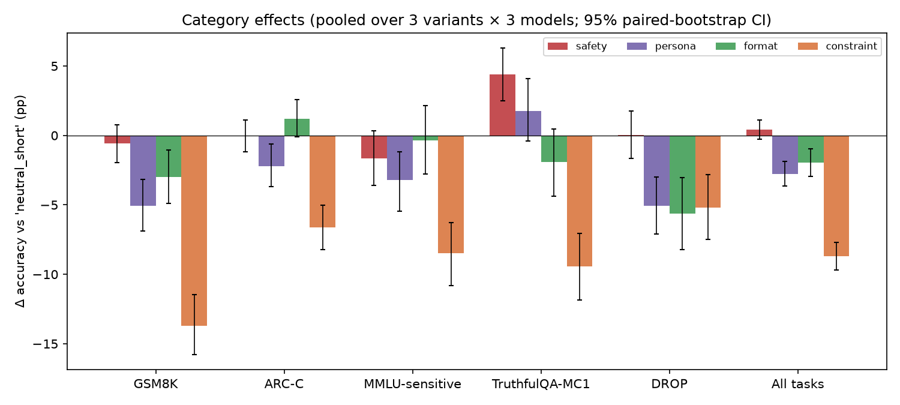

# System Prompt Residual Effects on Downstream Task Performance

## 1. Executive Summary

**Research question.** Do the system prompts that deployments commonly add (safety policies,
detailed personas, output-format rules, behavioural constraints) change accuracy, output length
and refusal behaviour on tasks they were not written for?

**Approach.** I ran a controlled experiment with 15 system prompts: 3 controls plus 4
categories × 3 wording variants. Each was run on 5 benchmarks (GSM8K, ARC-Challenge, a
"sensitive-subject" slice of MMLU, TruthfulQA-MC1 and DROP), 300 items each, with 3 open
instruction-tuned models (Qwen2.5-7B-Instruct, Llama-3.1-8B-Instruct,
Qwen3-4B-Instruct-2507). That is 67,500 greedy generations, plus a full 67,500-generation
sampling replicate (T=0.7). Every system-prompt effect is a
paired, item-level difference from the minimal control "You are a helpful assistant.", with
95% paired-bootstrap CIs and Holm correction.

**Key findings.** The hypothesis is mostly **not** supported as stated:
- **Safety prompts:** accuracy is essentially unchanged (+0.2 pp, CI [−0.4, +0.9]), and on
  TruthfulQA it is significantly *better* (+3.7 pp). They raise hedging (caveat phrases go
  from 1.4% to up to 7.2% of responses) but cause almost no refusals.
- **Persona prompts:** output length roughly **doubles** (×1.99; the hypothesis said
  +30–50%), and accuracy drops (−3.1 pp).
- **Format prompts:** they do *not* improve correctness (−2.5 pp lenient). They do make
  answers machine-parseable: +19.6 pp under a strict answer parser. Their main measurable
  downside is shortened reasoning on GSM8K (−4.2 pp). A further downside is a rule
  written for one task type misfiring on another: "give the option letter" led to answers
  like "R" for "Republican" on 18% of Qwen2.5's DROP answers.
- **Constraint prompts:** the most harmful category (−9.0 pp overall, down to −61 pp in one
  cell). Their per-cell effects are the most spread out. They hurt everywhere, though; they
  never helped on any task.

**Practical implication.** Safety-style system prompts are nearly free in accuracy terms for
these models. Brevity and style constraints, and to a lesser degree personas and rigid output
schemas, carry real hidden costs. Whether a format prompt looks helpful depends entirely on
whether you measure parseability or correctness.

## 2. Research Question & Hypothesis

The hypothesis tested, decomposed into four sub-hypotheses:

| ID | Claim |
|---|---|
| H1 | Safety-heavy system prompts reduce reasoning accuracy by 4–8 pp, via more hedging/refusal on ambiguous items |
| H2 | Detailed persona prompts increase output length by 30–50% without improving accuracy |
| H3 | Format-specification prompts are the only category that improves performance (+2–5 pp on structured tasks) |
| H4 | Constraint prompts show the largest variance across tasks: helping on some, hurting others by ≥10 pp |

**Why it matters.** Production system prompts sit in front of every request. If a safety
paragraph or a brand persona quietly costs accuracy or doubles token spend on unrelated
tasks, practitioners need to know. Evaluators also need to know whether benchmark numbers
without a system prompt carry over to deployed configurations.

## 3. Background (literature summary)

The resource-finding stage was skipped for this run: no `literature_review.md`, `papers/`,
`datasets/` or `code/` were provided. The following context is from the author's knowledge
and was not re-verified against papers in this workspace.
- *Persona / role prompts:* Zheng et al. (2023, "Is 'A Helpful Assistant' the Best Role for
  LLMs?") found that personas in system prompts give small, inconsistent changes in factual
  accuracy.
- *Format restrictions:* Tam et al. (2024, "Let Me Speak Freely?") report that forcing
  JSON/structured output can degrade reasoning, especially on math.
- *Over-refusal:* XSTest (Röttger et al., 2023) and OR-Bench document safety-tuned models
  refusing benign requests.
- *Prompt sensitivity:* Sclar et al. (2023) show large accuracy swings from superficial
  prompt-format changes.

None of these compares the four categories of system prompt side by side, with
length-matched controls, on the same tasks and models. That gap is what this study fills.

## 4. Methodology

### 4.1 Models and inference
| Model | HF snapshot | Precision used (greedy run) |
|---|---|---|
| Qwen2.5-7B-Instruct | `Qwen/Qwen2.5-7B-Instruct` | bf16, 1×A6000 |
| Llama-3.1-8B-Instruct | `unsloth/Meta-Llama-3.1-8B-Instruct` (identical weights to Meta's) | bf16, 1×A6000 |
| Qwen3-4B-Instruct-2507 | `Qwen/Qwen3-4B-Instruct-2507` | FP8 weight-only, 2-GPU tensor parallel |

- **Why local models:** no API keys (OpenRouter/OpenAI) were available on this host, so I
  used real open-weight models served with **vLLM 0.31.0**, not simulated agents.
- **Why Qwen3 ran in FP8:** the host's GPUs were heavily shared with other jobs, and FP8 was
  the only way to fit it. All comparisons are paired *within* a model, so precision
  differences between models cannot confound the system-prompt effects.
- **Decoding:** greedy (temperature 0), max 1,024 new tokens, max context 4,096.
- **Replicate:** a full-grid sampling run (T=0.7, top-p 0.95, seed 1, bf16 for all three
  models) checks robustness (§5.7).

### 4.2 Tasks (300 items each, sampled with seed 42)
| Task | Source | Type | Why |
|---|---|---|---|
| GSM8K | test split | numeric math reasoning | multi-step reasoning, sensitive to reasoning length |
| ARC-Challenge | test split | 3–5-way MC science | standard reasoning MC |
| MMLU-sensitive | test split, 14 subjects (medicine, law, security, morality, psychology, sexuality, …) | 4-way MC | items where safety prompts plausibly trigger hedging/refusal |
| TruthfulQA-MC1 | validation | MC (≤6 options, shuffled) | misconception-laden, "ambiguous" items |
| DROP | validation, single-gold-span items | short answer (number/span) | structured extraction |

The **user turn is identical across conditions** and carries only a minimal instruction
("Solve the following math problem.", "Answer the following multiple-choice question.",
"Read the passage and answer the question."). The system prompt is the only thing that
varies.

### 4.3 System prompt conditions (full text in `src/prompts.py`)
| Group | Conditions |
|---|---|
| Controls | `none` (no system message); `neutral_short` = "You are a helpful assistant." (**baseline**); `neutral_long` = ~150-word behaviourally empty deployment blurb (length-matched control) |
| Safety | A: harm-avoidance + disclaimers + "err on the side of caution"; B: 7 numbered safety rules incl. "if ambiguous, ask for clarification"; C: strict content policy + acknowledge uncertainty |
| Persona | A: Prof. Eleanor Hart (warm British lecturer, anecdotes); B: Max (joking start-up engineer); C: Dr. Amara Okafor (thorough polymath consultant) |
| Format | A: step-by-step then `Final Answer: <x>` line; B: `## Reasoning` / `## Answer` markdown sections; C: JSON `{"reasoning", "answer"}` |
| Constraint | A: <50 words, no intermediate work; B: plain prose only, no lists/markdown/LaTeX, ≤3 paragraphs, formal; C: ≤3 sentences, no follow-up questions, no hedging words, commit to one answer |

### 4.4 Scoring
- **Lenient accuracy** (primary; approximates whether the *content* is right):
  1. Use the explicit answer marker if present.
  2. Otherwise fall back to robust extraction: last number for GSM8K; for MC, the bolded,
     initial or closing option letter, exact option text, then a conservative fuzzy match
     of option text.
  3. For DROP: the gold answer must be contained in the answer line or sentence (numbers
     matched numerically).
- **Strict accuracy** (secondary; approximates a production parser): requires an explicit
  marker (JSON `answer`, `Final Answer:`, `## Answer`, `Answer:`, "the answer is",
  `\boxed{}`).
- **Behaviour:** output tokens, refusal / clarification-request regex, hedge/caveat regex,
  unparseable rate.
- **Parser validation:** the lenient MC extractor was iteratively fixed after inspecting
  failures. A final hand audit of 30 random fallback extractions found 29/30 consistent with
  the response text (~3% error). Residual parse failures are reported per condition (§5.5)
  and handled by a robustness check (§5.6).

### 4.5 Statistics
- **Per cell (model × task × condition):** paired difference vs. baseline, exact McNemar
  test, and 95% bootstrap CI that resamples items (2,000 resamples).
- **Per category:** mean over its 3 variants × 3 models (tasks weighted equally), with a
  paired item-bootstrap CI. Holm correction across the 4 categories × 5 tasks family.
- **Length:** ratio of mean output tokens to baseline.
- **H4 dispersion:** SD of effects across tasks (with bootstrap CI) and across all 45
  cells per category.

## 5. Results

All numbers below are greedy decoding, pooled over 3 models, in percentage points vs.
`neutral_short`, unless stated otherwise.

Baseline (`neutral_short`) lenient accuracy:

| Model | GSM8K | ARC-C | MMLU-sens | TruthfulQA | DROP |
|---|---|---|---|---|---|
| Llama-3.1-8B | 84.3 | 87.0 | 67.0 | 55.3 | 85.7 |
| Qwen2.5-7B | 93.7 | 93.0 | 63.3 | 63.0 | 82.3 |
| Qwen3-4B | 95.0 | 94.0 | 67.7 | 68.0 | 85.7 |

### 5.1 Main result: category effects on accuracy

**Lenient accuracy Δ (pp) [95% CI]:**

| Category | GSM8K | ARC-C | MMLU-sens | TruthfulQA | DROP | **All tasks** | Length ratio |
|---|---|---|---|---|---|---|---|
| Safety | −0.8 | −0.4 | −1.6 | **+3.7** [2.0, 5.3]* | +0.3 | **+0.2** [−0.4, 0.9] | 1.07× |
| Persona | **−5.7*** | **−2.4*** | **−3.4*** | +1.4 | **−5.4*** | **−3.1** [−4.0, −2.2] | **1.99×** |
| Format | **−4.2*** | +0.6 | −0.6 | −2.1 | **−6.4*** | **−2.5** [−3.6, −1.6] | 0.95× |
| Constraint | **−14.3*** | **−6.4*** | **−8.8*** | **−8.6*** | **−7.1*** | **−9.0** [−10.0, −8.1] | 0.41× |
| *Control: none* | −1.8 | −0.2 | −0.3 | +0.2 | −0.2 | −0.5 [−1.1, 0.1] | 0.97× |
| *Control: neutral_long* | −1.6 | −0.8 | −2.0 | −1.8 | −0.7 | −1.4 [−2.1, −0.6] | 0.94× |

\* Holm-adjusted p < 0.05 (category × task family of 20 tests).

**Strict accuracy Δ (pp)**, where an explicit answer marker is required:

| Category | GSM8K | ARC-C | MMLU-sens | TruthfulQA | DROP | **All tasks** |
|---|---|---|---|---|---|---|
| Safety | −5.4 | −5.0 | −7.7 | −5.6 | +1.7 | **−4.4** [−5.2, −3.7] |
| Persona | −31.5 | −18.0 | −15.8 | −14.4 | +5.5 | **−14.8** |
| Format | +23.9 | +9.3 | +4.2 | +2.6 | +58.1 | **+19.6** [18.5, 20.8] |
| Constraint | −55.6 | −62.4 | −45.5 | −41.6 | −18.9 | **−44.8** |

Per-condition detail:

### 5.2 Per-model category effects (lenient, mean over tasks and variants)

| Category | Llama-3.1-8B | Qwen2.5-7B | Qwen3-4B |
|---|---|---|---|
| Safety | −0.7 | +0.3 | +1.1 |
| Persona | −4.4 | −5.1 | +0.2 |
| Format | −4.1 | −3.7 | +0.2 |
| Constraint | −4.6 | −14.2 | −8.2 |
| *Persona length ratio* | 2.10× | 1.76× | 2.11× |

The newest model, Qwen3-4B, is the most robust: personas and formats cost it nothing.
Constraints still cost it 8 pp.

### 5.3 Output length

- **Personas:** about 2× longer outputs. Per-cell ratios range from 0.89× (Qwen2.5,
  GSM8K) to 3.4×, and on MC tasks they are 1.8–2.6×.
- **Safety:** +7%.
- **Format:** −5%. JSON is much shorter (0.65× on GSM8K); `Final Answer` is slightly longer.
- **Constraints:** −59%.
- **Length-matched neutral control:** does not lengthen outputs (0.94×). The persona length
  effect therefore comes from persona *content*, not prompt length.

### 5.4 Hedging and refusal

| Condition | Refusal / clarification % | Hedge / caveat % | Unparseable % |
|---|---|---|---|
| neutral_short | 0.2 | 1.4 | 0.2 |
| neutral_long | **1.1** | 1.7 | 1.2 |
| safety_A / B / C | 0.3 / 0.6 / 1.0 | **7.2** / 4.0 / 2.5 | 0.9 / 1.0 / 0.8 |
| persona_A / B / C | 0.1 / 0.5 / 0.1 | 3.8 / 2.5 / 3.6 | 1.9 / 1.2 / 1.2 |
| format_A / B / C | ≤0.2 | ≤0.5 | ≤0.3 |
| constraint_A / B / C | 0.0 | 0.0 / 1.6 / 0.1 | 0.3 / **7.4** / 2.9 |

- **Safety prompts:** they raise hedging (up to 5× baseline) but barely change refusals.
  Almost all refusals came from Llama (e.g. "I cannot provide information that could be
  used to harm the environment" on an ARC ecology question).
- **Surprise:** the behaviourally empty `neutral_long` blurb made Llama refuse off-topic
  questions ("I can't answer that question as it is not related to the Northwind Learning
  Hub"; 3.1% of Llama responses). The Qwen models never did this.

### 5.5 How items flip from right to wrong (error taxonomy)

Items correct under baseline but wrong under the condition (all models, 4,500 item-model
pairs per condition):

| Condition | → wrong | → right | net | refusal | unparseable | hedged-wrong | plain wrong |
|---|---|---|---|---|---|---|---|
| safety_A | 162 | 180 | **+0.4** | 2 | 17 | 21 | 122 |
| safety_B | 162 | 176 | +0.3 | 6 | 12 | 9 | 135 |
| persona_A | 450 | 258 | −4.3 | 1 | 53 | 14 | 382 |
| format_C (JSON) | 441 | 264 | −3.9 | 1 | 2 | 1 | 437 |
| constraint_A | 544 | 157 | −8.6 | 1 | 3 | 0 | 540 |
| constraint_B | 593 | 187 | −9.0 | 0 | **223** | 10 | 360 |

Failure mechanisms:
- **Safety:** losses are balanced by gains. Refusal is not a meaningful failure mode.
- **Persona:** chatty digressions and lost focus show up as plain wrong answers. Some
  responses end without committing ("…Isn't it fascinating…?").
- **Format:**
  - JSON and markdown-section formats compress the reasoning into a plan without doing the
    arithmetic. Example: format_B on GSM8K gave four reasoning bullets ("Subtract … to find
    the leftover money"), then `## Answer 100000` (gold 40000).
  - format_A's MC rule spills over onto DROP. "For multiple-choice questions the final answer
    must be the single letter" led Qwen2.5 to answer DROP questions with a single letter in
    18% of cases ("Final Answer: R" for *Republican*, "J" for *Jeff Garcia*).
- **Constraint:**
  - constraint_A ("<50 words, don't show work") removes chain-of-thought and collapses GSM8K
    for Qwen2.5 (−61 pp).
  - constraint_B (plain prose) makes models paraphrase an option without its letter
    (unparseable in 7–16% of MC answers), and also lowers content accuracy.

### 5.6 Robustness checks
- **Answered-only accuracy:** restricting to items where an answer was extracted under both
  baseline and condition leaves the ordering unchanged. Safety +0.5, persona −2.3,
  format −2.6, constraint −6.9 pp. Parse failures explain part of the persona and
  constraint losses, but not all.
- **Prompt length:** the length-matched control costs only −1.4 pp. The large persona and
  constraint effects are therefore content-driven.
- **Wording variants:**
  - Safety: all 3 variants improve TruthfulQA (+2.8 to +4.3) and are within ±2.6 pp of
    baseline on every other task (they disagree in sign only on DROP: +0.7, +0.8, −0.6).
  - Format: format_A is slightly positive on GSM8K, ARC and MMLU (+0.7 to +1.2) but −1.9 on
    TruthfulQA and −6.2 on DROP; format_C (JSON) is −10.1 on GSM8K. *Which* format matters more than "format vs. not".
  - Persona: persona_C (thorough consultant) is much less harmful than A and B.
- **MMLU-sensitive by subject (safety vs. baseline):** the largest drop is on
  moral_scenarios (−8.3 pp, 59 items × 3 models), which is consistent with caution on morally
  loaded judgments. Medical subjects changed by −5.6 to +3.7 pp on small samples (5–19 items
  per subject), so nothing per-subject is conclusive.

### 5.7 Sampling replicate (T = 0.7)
The full grid (3 models × 15 conditions × 1,500 items = 67,500 more generations) was rerun
with T=0.7, top-p 0.95, vLLM seed 1. All three models used bf16 weights on a single GPU for
this run. For Qwen3-4B this means the replicate also differs from its greedy run in precision
(FP8 vs. bf16), so for that model the replicate tests robustness to decoding *and*
quantisation.

**Category effects, greedy vs. T=0.7** (pp vs. `neutral_short`, pooled over models and tasks, 95% CI):

| Category | Greedy lenient | T=0.7 lenient | Greedy strict | T=0.7 strict | Length ratio (greedy / T=0.7) |
|---|---|---|---|---|---|
| Safety | +0.2 [−0.4, 0.9] | +0.4 [−0.3, 1.1] | −4.4 | −5.1 | 1.07× / 1.07× |
| Persona | −3.1 [−4.0, −2.2] | −2.8 [−3.6, −1.9] | −14.8 | −15.2 | 1.99× / 1.99× |
| Format | −2.5 [−3.6, −1.6] | −2.0 [−2.9, −1.0] | +19.6 | +20.2 | 0.95× / 0.94× |
| Constraint | −9.0 [−10.0, −8.1] | −8.7 [−9.7, −7.7] | −44.8 | −44.8 | 0.41× / 0.41× |
| *Control: neutral_long* | −1.4 | −1.1 | — | — | 0.94× / 0.95× |

The T=0.7 task-level pattern is also the same. Safety still improves TruthfulQA (+4.4 pp,
Holm p < 0.05) and is non-significant elsewhere. Persona and format still hurt GSM8K and
DROP the most (persona −5.1 / −5.1, format −3.0 / −5.6). Constraint is still the worst on
every task (GSM8K −13.7).

Per model (T=0.7, lenient, mean over tasks and variants), the robustness of Qwen3-4B to
persona and format holds (+0.7, +1.1). The costs for Llama (−4.1, −2.8) and Qwen2.5 (−4.9,
−4.1) also hold, and Qwen2.5 is again the model most hurt by constraints (−14.4).

**Cell-level agreement:** 210 non-baseline model × task × condition cells were compared.
- Effects correlate strongly: Pearson r = 0.95, Spearman ρ = 0.87. Per model, r = 0.84
  (Llama), 0.98 (Qwen2.5) and 0.93 (Qwen3).
- The mean absolute difference between greedy and sampled effects is 1.7 pp.
- Of the 63 cells significant under greedy (McNemar p < 0.05), 98% keep their sign at
  T=0.7, and 81% are again significant with the same sign.
- Overall sign agreement is only 76%. The disagreements come from near-zero cells: for
  cells with |greedy Δ| < 2 pp, signs agree only 59% of the time, close to chance. Small
  per-cell effects should therefore be read as noise.

**H4 dispersion at T=0.7:** constraint again has the widest cell-level spread (SD 10.8 vs.
2.9–5.5 pp) and the most cells ≤ −10 pp (14/45). Its across-task SD (3.3 [2.3, 4.4]) again
overlaps with the other categories. It has 0/45 significantly positive cells, and its best
cell is only +2.3 pp.

**Behaviour at T=0.7:** safety prompts again raise hedging (safety_A 6.8% vs. baseline
1.3%), refusals stay ≤ 0.9% in every condition, and `neutral_long` again produces scope
refusals (0.9%). Format prompts again yield 99.4–99.8% explicit answer markers vs. 71.7%
at baseline.

**Conclusion:** every qualitative finding and every hypothesis verdict in §6 is unchanged
under sampling. Category-level magnitudes move by ≤ 0.6 pp (lenient) and ≤ 0.7 pp (strict).

## 6. Hypothesis evaluation

| Hypothesis | Verdict | Evidence |
|---|---|---|
| **H1** Safety −4 to −8 pp via hedging/refusal | **Not supported** (for content accuracy) | Lenient Δ = +0.2 [−0.4, 0.9]. TruthfulQA *improves* +3.7. Hedging rises (1.4% → up to 7.2%), refusals stay ≤1%. Only under **strict** parsing does safety show −4.4 pp, because safety-prompted answers less often use an explicit answer marker (63–68% vs. 73%). That is a parsing effect, not a reasoning effect. |
| **H2** Persona +30–50% length, no accuracy gain | **Partly supported** (direction yes, magnitude no) | Length ×1.99 [1.96, 2.03], well above the 1.3–1.5 range. Accuracy does not improve and actually **drops** −3.1 pp (−4 to −5 pp for Llama and Qwen2.5, 0 for Qwen3). |
| **H3** Format is the only helpful category (+2–5 pp structured) | **Not supported** for correctness; **supported only for parseability** | Lenient Δ = −2.5 overall and −2.1 on structured tasks; GSM8K −4.2, DROP −6.4. Strict Δ = +19.6, so format prompts are the only category that helps a production parser. Safety, not format, is the only category with a non-negative content effect. |
| **H4** Constraint has largest variance, helps some tasks, hurts others ≥10 pp | **Partly supported** | Constraint has by far the largest cell-level spread (SD 10.1 pp vs. 2.5–5.3) and 12/45 cells ≤ −10 pp (min −61). But across-task SD of the pooled effect (3.1) is not distinguishable from persona/format (2.8, CIs overlap). It **never helps**: best cell −1.0 pp, 0/45 cells significantly positive. The variance is "hurts a little vs. hurts catastrophically", not "helps vs. hurts". |

## 7. Discussion

- **Why the hypothesis overestimated safety costs.** Modern instruction-tuned models seem to
  treat safety boilerplate as a tone instruction: they add caveats and disclaimers, but
  still commit to an answer on benign academic questions. The TruthfulQA *gain* fits a
  mechanism where "do not present uncertain information as fact" counteracts the pull toward
  popular misconceptions, the very thing TruthfulQA measures. The one real cost is mild:
  slightly lower accuracy on moral-judgment items and occasional refusals by Llama on
  harmless topics.
- **Why format prompts disappoint.** Format prompts trade reasoning space for structure.
  Asking for "brief" reasoning (B) or a JSON string (C) shortens chain-of-thought, which
  hurts multi-step math, consistent with "Let Me Speak Freely?". They also generalize rules
  literally across task types (the DROP letter spill-over). But they nearly eliminate
  parsing failures (strict-marker rate 99.5% vs. 73%). For a pipeline that cannot parse free
  text, a format prompt is still a large net win. The right design is to request the format
  *after* unconstrained reasoning (format_A style), with task-type-specific rules.
- **Constraints are the dangerous category.** Length and style limits written for UX reasons
  ("keep it short", "no lists") remove the reasoning tokens the model needs, and make answers
  harder to grade. The damage is largest on multi-step math and for the model that relies
  most on visible reasoning (Qwen2.5).
- **Model dependence.** Qwen3-4B-2507 is largely immune to persona and format residue, while
  Llama-3.1-8B and Qwen2.5-7B are not. Residual effects are partly a property of
  instruction tuning, so practitioners should measure on their own model rather than assume
  any fixed penalty.

## 8. Limitations

- **Models:** three 4–8B open models only. Frontier API models (GPT-4.1/5, Claude, Gemini)
  were unavailable (no API keys) and may behave differently, especially on refusal.
- **Precision:** Qwen3-4B's greedy run used FP8 weights (because of GPU contention). Effects
  are within-model, so this does not bias comparisons. Its bf16 T=0.7 replicate gives the same
  effects (r = 0.93 at cell level), and its absolute accuracies are within 1 pp of the FP8 run.
- **Prompt sampling:** three hand-written variants per category is a small sample of the
  space of real system prompts. Variant-level heterogeneity is substantial (e.g. format_A
  vs. format_C).
- **Scoring:** lenient extraction is heuristic (~3% audit error on fallbacks). DROP
  containment scoring can credit answers that list several candidates. Hedge and refusal
  detection is regex-based and will miss paraphrases.
- **Truncation:** max 1,024 tokens truncated 1.7–1.8% of persona responses (vs. 0.6%
  baseline), which slightly inflates persona losses.
- **Scale:** 300 items per task gives CIs of about ±1–2 pp for pooled category effects but
  ±3–5 pp per cell. Per-subject MMLU results are underpowered.
- **No literature resources** were provided to this run. Prior-work statements are from
  memory and should be checked.

## 9. Conclusions & Next Steps

For three current open instruct models:
- Safety-heavy system prompts do **not** reduce reasoning accuracy. They add hedging, and
  they modestly *improve* truthfulness.
- Persona prompts double output length and slightly reduce accuracy.
- Format prompts make outputs parseable but do not make them more correct, and rigid
  schemas can shorten reasoning.
- Constraint prompts are consistently the most harmful, catastrophically so when they ban
  visible reasoning.

Practically, auditing a system prompt for *constraints on length and style* matters far more
than worrying about safety boilerplate.

**Follow-ups:**
1. Repeat with frontier API models, where refusal behaviour differs.
2. Vary the *strength* of each category (dose-response).
3. Test "reason freely, then format" two-stage prompts to see if format benefits can be
   kept without the reasoning cost.
4. Use an LLM judge to score prose answers, removing parser dependence.
5. Study the scope-refusal effect of deployment-context blurbs (Llama's `neutral_long`
   refusals) systematically.

## 10. Reproducibility

- Environment: `uv venv --python 3.12`, then `uv sync` from `pyproject.toml`/`uv.lock`. Key
  versions: vllm 0.31.0, torch 2.13.0+cu130, numpy 2.3.5, pandas 3.0.6, scipy 1.18.1,
  statsmodels 0.15.0, matplotlib 3.11.2.
- Hardware: NVIDIA RTX A6000 (48 GB), shared with other users' jobs.
- Wall time for greedy runs: Qwen2.5 38 min, Llama 61 min, Qwen3 (FP8, TP2) 66 min.
  T=0.7 runs (bf16, one GPU): Qwen2.5 23 min, Llama 29 min, Qwen3 about 42 min.
- Output tokens per run: about 3.3M (Qwen2.5), 3.4–3.5M (Llama) and 5.6–5.7M (Qwen3).
- In total: 135,000 generations, about 25M output tokens.
- API cost: $0 (local inference).
- Seeds: item sampling 42; vLLM seed 0 (greedy) and 1 (T=0.7); bootstrap 42.
- `VLLM_USE_FLASHINFER_SAMPLER=0` is required on this host (the FlashInfer JIT build fails).
- Steps: `python src/data.py` → `bash src/run_all.sh` (or `python src/run.py --model …`) →
  `python src/score.py` → `python src/analyze.py` → `python src/error_analysis.py`.

## References

- Cobbe et al. 2021, GSM8K. Clark et al. 2018, ARC. Hendrycks et al. 2021, MMLU. Lin et al.
  2022, TruthfulQA. Dua et al. 2019, DROP.
- Zheng et al. 2023, "Is 'A Helpful Assistant' the Best Role for Large Language Models?"
- Tam et al. 2024, "Let Me Speak Freely? A Study on the Impact of Format Restrictions on LLM
  Performance."
- Röttger et al. 2023, "XSTest." Cui et al. 2024, "OR-Bench."
- Sclar et al. 2023, "Quantifying Language Models' Sensitivity to Spurious Features in Prompt
  Design."
- Kwon et al. 2023, vLLM (PagedAttention).
